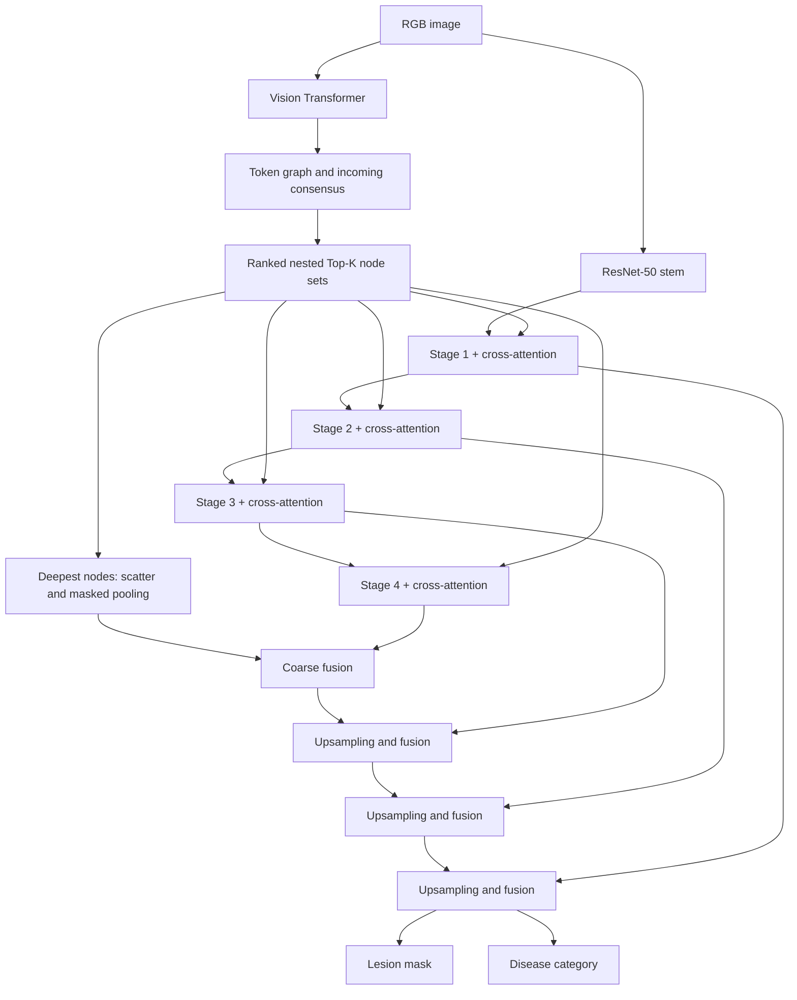

<div align="center">

# NPF-Net

### Node-guided Pyramid Fusion Network for Crop Disease Classification and Lesion Segmentation

**Structural prompting · Stage-wise cross-attention · Cross-scale fusion**


[Method](#-method) · [Installation](#-installation) · [Data](#-data-preparation) · [Training](#-training-and-evaluation) · [Verification](#-verification)

</div>

---

## Overview

NPF-Net addresses joint image-level crop disease classification and pixel-level lesion segmentation in complex field imagery. The architecture combines a ResNet-50 backbone with a Vision Transformer (ViT), ranks patch tokens by their incoming graph attention weights, and uses nested node subsets to guide convolutional features at four spatial scales. A top-down pyramid propagates coarse structural information into finer feature maps before joint prediction.

The implementation follows the architectural specification and Eqs. (1–15) of the NPF-Net manuscript. Implementation choices not fully specified in the manuscript are documented below.

## 🧩 Method



### Node consensus and hierarchical prompting

For token features $T\in\mathbb{R}^{N\times d}$, the graph adjacency is

$$ A_{mn}=\frac{\exp((t_m W_q)(t_n W_k)^\top/\sqrt d)}{\sum_j\exp((t_m W_q)(t_j W_k)^\top/\sqrt d)},\qquad s_n=\frac{1}{N}\sum_m A_{mn}. $$

Each row of $A$ is normalized over destination tokens. Node scores therefore aggregate columns rather than rows. The ranking is shared across scales, and each stage retains the first $K_s=H_sW_s$ indices. At the default resolution, the corresponding tensor dimensions are:

| ResNet stage | Spatial grid | Channels | Selected nodes |
|:---|---:|---:|---:|
| Stage 1 | 64 × 64 | 256 | 4,096 |
| Stage 2 | 32 × 32 | 512 | 1,024 |
| Stage 3 | 16 × 16 | 1,024 | 256 |
| Stage 4 | 8 × 8 | 2,048 | 64 |

The graph computation accumulates incoming weights in query blocks without retaining the full adjacency tensor. Stage 1 uses the entire patch sequence; deeper stages use progressively smaller nested subsets.

### Stage-wise guidance and pyramid fusion

At stage $s$, the flattened convolutional features $F_s$ serve as queries and the selected node matrix $Z_s$ supplies keys and values:

$$ F'_s=F_s+\operatorname{softmax}\left(\frac{(F_sW_q^{(s)})(Z_sW_k^{(s)})^\top}{\sqrt d}\right)Z_sW_v^{(s)}. $$

The enhanced features propagate through the subsequent ResNet stage. The deepest subset is scattered onto the original 64 × 64 patch grid and aggregated with an 8 × 8 masked average pooling window. Empty regions are assigned zeros. The reconstructed feature map is concatenated with the deepest convolutional features. The resulting pyramid uses bilinear upsampling, lateral concatenation, and 1 × 1 convolutions.

### Joint objective

$$ \mathcal L=\mathcal L_{\mathrm{BCE}}+\mathcal L_{\mathrm{Dice}}+0.5\mathcal L_{\mathrm{CE}}+0.1\mathcal L_{\mathrm{TV}}. $$

Binary cross-entropy and Dice supervise lesion masks; categorical cross-entropy supervises disease labels. Anisotropic total variation penalizes valid neighboring-pixel differences in the predicted lesion probability map. The training objective operates on logits using numerically stable loss functions.

## 📁 Repository structure

```text
NPF-Net/
├── config.py       # Architecture and optimization settings
├── model.py        # ViT, consensus ranking, cross-attention, pyramid and heads
├── objectives.py   # Joint segmentation, classification and TV objective
├── data.py         # Fixed partitions, paired images and binary masks
├── metrics.py      # Accuracy, Macro-F1, mIoU and Boundary F1
├── train.py        # Training, checkpoint selection and held-out evaluation
├── test_npf.py     # Numerical checks and end-to-end tests
└── README.md       # Method and experimental protocol
```

## ⚙️ Installation

The manuscript specifies Python 3.10, PyTorch 2.1.0, and an NVIDIA RTX 3060. Install the PyTorch build appropriate for the available CUDA runtime or CPU, then install the remaining dependencies.

```bash
python -m venv .venv
# Linux/macOS:
source .venv/bin/activate
# Windows PowerShell: .venv\Scripts\Activate.ps1

pip install torch==2.1.0 torchvision==0.16.0
pip install numpy==1.26.4 scipy==1.11.4 Pillow==10.4.0 pytest==8.3.5
```

For platform-specific PyTorch wheels, consult the [PyTorch installation guide](https://pytorch.org/get-started/previous-versions/). The executable verification in this package used PyTorch 2.10.0 and torchvision 0.25.0 on CPU; the stated PyTorch 2.1 environment has not been executed here.

## 📂 Data preparation

The manuscript evaluates two datasets separately:

| Dataset | Images | Image-level classes | Crops |
|:---|---:|---:|:---|
| NBCD | 13,024 | 14 | Corn, potato, rice, wheat |
| CPDD | 24,881 | 22 | Cashew, cassava, maize, tomato |

Use the original image-level category labels and the corresponding manually annotated binary lesion masks. Export the LabelMe polygons as a single foreground mask per image. Healthy images require an all-zero mask. The loader accepts single-channel or indexed binary masks encoded as 0/1 or 0/255; it also accepts identical RGB channels. Nearest-neighbor resizing preserves the binary labels.

Maintain the fixed 72%/8%/20% training, validation, and test partitions specified in the manuscript. Provide a CSV manifest for each dataset:

```csv
image,mask,label,split
images/train_0001.jpg,masks/train_0001.png,0,train
images/val_0001.jpg,masks/val_0001.png,1,val
images/test_0001.jpg,masks/test_0001.png,2,test
```

Paths are relative to the manifest location unless absolute. Class indices must be consecutive integers from 0 to `num_classes - 1`; maintain a consistent category-to-index mapping across partitions. All three partitions must be nonempty. Duplicate paths are rejected, including resolved symbolic links. Content-level duplicates and acquisition-group overlap must be checked against the original dataset metadata before partitioning.

The images, annotated masks, exact split assignments, and trained checkpoints are not bundled.

## 🚀 Training and evaluation

### Default configuration

| Setting | Value |
|:---|:---|
| Input / patch size | 256 × 256 / 4 × 4 |
| ViT embedding / layers | 768 / 12 |
| Dropout | 0.3 |
| Epochs / batch size | 150 / 16 |
| Optimizer | Adam ($\beta_1=0.9$, $\beta_2=0.999$) |
| Weight decay | $10^{-4}$ |
| Initial / minimum learning rate | $10^{-4}$ / $10^{-6}$ |
| LR schedule | Cosine annealing |
| Segmentation / classification / TV weights | 1.0 / 0.5 / 0.1 |

Train on NBCD:

```bash
python train.py --manifest data/NBCD/manifest.csv --num-classes 14 --output runs/NBCD --seeds 0 1 2 3 4 5 6 7 8 9
```

Train on CPDD:

```bash
python train.py --manifest data/CPDD/manifest.csv --num-classes 22 --output runs/CPDD --seeds 0 1 2 3 4 5 6 7 8 9
```

The ten integers above define a reproducible execution sequence; replace them with the original experimental seeds if available. Each run independently initializes the model, uses the same fixed data partitions, selects the checkpoint with the highest validation mIoU, and evaluates that checkpoint on the held-out test set. The test set is not consulted during checkpoint selection.

### Memory management

The default 4 × 4 patch size yields 4,096 tokens, making dense attention computationally demanding. Query-block processing, activation checkpointing, and CUDA automatic mixed precision reduce memory pressure without changing the node-selection equations. If the physical batch of 16 exceeds available memory, use a smaller batch and gradient accumulation:

```bash
python train.py --manifest data/NBCD/manifest.csv --num-classes 14 --output runs/NBCD_low_memory --batch-size 2 --accumulation-steps 8 --query-chunk 128 --seeds 0
```

Gradient accumulation preserves the nominal effective batch size, but BatchNorm statistics differ from those obtained with a physical batch of 16. Report the actual execution settings. Full-resolution GPU training and memory consumption require measurement on the intended device.

### Outputs

```text
runs/NBCD/
├── seed_0/
│   ├── config.json        # Settings, seed, partition sizes and manifest hash
│   ├── history.json       # Training and validation metrics by epoch
│   ├── best.pt            # Validation-selected model weights
│   └── test_metrics.json  # Held-out metrics for the selected checkpoint
├── seed_1/
│   └── ...
└── summary.json          # Per-run metrics, means and sample standard deviations
```

Metrics are stored as fractions in `[0, 1]`. Multiply by 100 for percentage reporting. A single run has no sample standard deviation. Repeated seeds measure variation on a fixed partition; they do not constitute independent test cohorts or k-fold cross-validation.

### Metric definitions

| Metric | Aggregation |
|:---|:---|
| Accuracy | Correct image predictions divided by all evaluated images |
| Macro-F1 | Unweighted mean of F1 across configured image-level classes |
| mIoU | Mean of foreground and background IoU from global pixel counts |
| BF1 | Harmonic mean of dataset-level boundary precision and recall; Euclidean tolerance of two pixels |

Undefined class F1 is set to zero. A pixel class with zero union is omitted from mIoU. Boundaries use four-connected inner contours; matching is computed independently in both directions. If neither contour direction has support, BF1 is set to zero. These edge-case conventions are explicit implementation choices.

## 🔬 Verification

Run the automated test suite:

```bash
python -m pytest -q test_npf.py
```

| Review pass | Scope | Resolution |
|:---|:---|:---|
| I — Numerical consistency | Incoming graph scores, spatial reconstruction, cross-attention, objective, metrics | Reject invalid pooling targets before division; all five numerical checks pass after correction. |
| II — Model and data integration | Default settings, four-stage gradients, checkpoint round-trip, indexed masks and split isolation | Preserve palette indices during mask loading; use a nondegenerate spatial grid for attention-gradient checks. Eight checks pass. |
| III — Execution and evaluation | Metric input contracts, incomplete accumulation groups, two independent CPU training runs and held-out evaluation | Reject incompatible metric tensors before updating counters; validate accumulation and device settings. Eleven checks pass. |

All eleven checks passed in the final CPU test run. A separate full-configuration CPU inference check used a 256 × 256 RGB input, all 12 Transformer layers, 768-dimensional tokens, and 14 disease classes. The output shapes were `[1, 1, 256, 256]` and `[1, 14]`, and all logits were finite. The training integration tests use compact model settings and deterministic test fixtures. These tests verify software behavior and do not establish classification or segmentation performance on NBCD or CPDD.

## Implementation notes

- **Graph projections.** Hard Top-K selection does not differentiate through the ranking indices. The graph shares bias-free query and key projection weights with the final ViT attention layer so that those weights receive training gradients through the Transformer. The hard ranking itself is detached; no auxiliary score loss or straight-through estimator is added. This weight-sharing choice is not specified in the manuscript.
- **Backbone and fusion.** The ViT uses learned spatial positional embeddings, 12 attention heads, a feed-forward expansion ratio of four, pre-normalization, and GELU. ResNet-50 is initialized without pretrained weights. Fusion preserves each ResNet stage's channel width; the prediction heads use a 1 × 1 mask convolution and global average pooling followed by a linear classifier. These settings complete the architectural details not fixed by the manuscript. Images use ImageNet normalization, with no stochastic augmentation by default.
- **Prediction resolution.** Applying the linear mask head before integer-factor bilinear upsampling is equivalent to applying it afterward. Global average pooling before this upsampling preserves the spatial mean, avoiding an unnecessary full-resolution feature tensor.
- **Complexity.** The 14-class default model contains 129,908,559 trainable parameters, as counted directly from its tensors. This differs from the 127.36 M parameter count in the manuscript's Table 5; the exact original architecture and profiler are required to reconcile the discrepancy. GFLOPs, FPS, peak GPU memory, and dataset-level performance have not been measured for this implementation.
- **Experimental scope.** This package implements the complete NPF-Net architecture and its training protocol. It does not include comparison architectures, ablation variants, original data partitions, pretrained checkpoints, or experimental result tables. The original data and execution environment are required for empirical reproduction.

---

<div align="center">
<sub>NPF-Net · Structural learning for crop disease analysis</sub>
</div>
